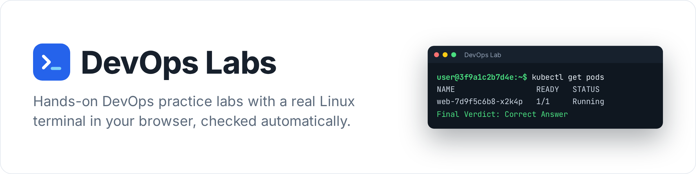
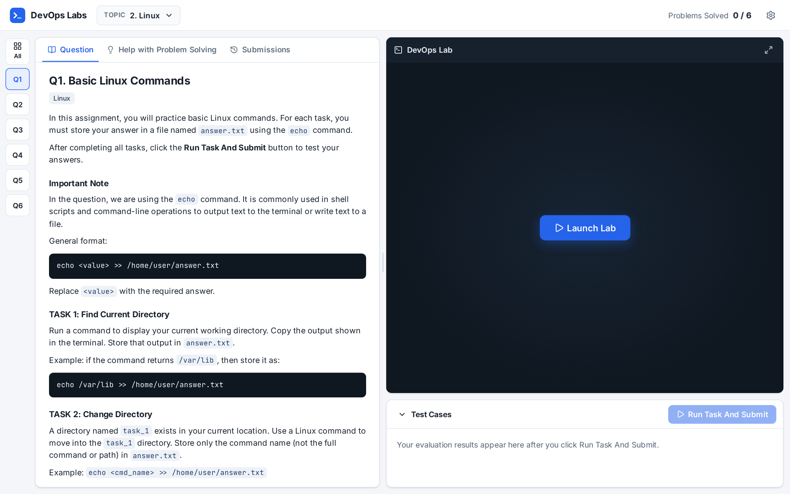
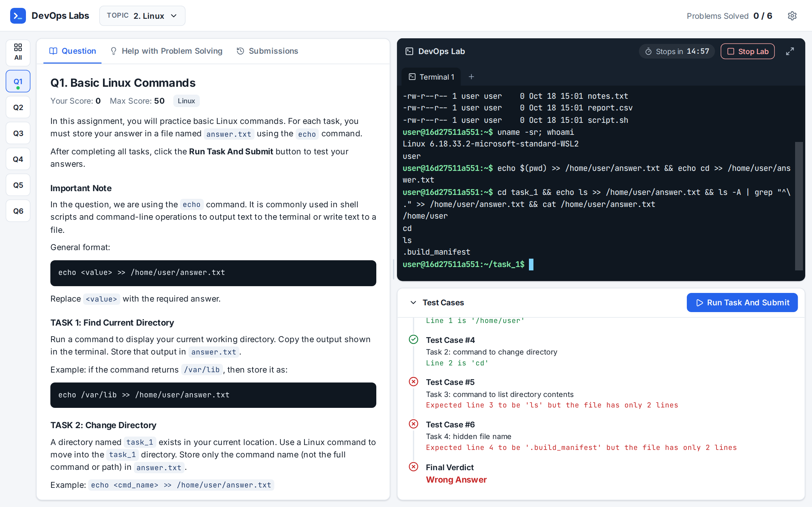
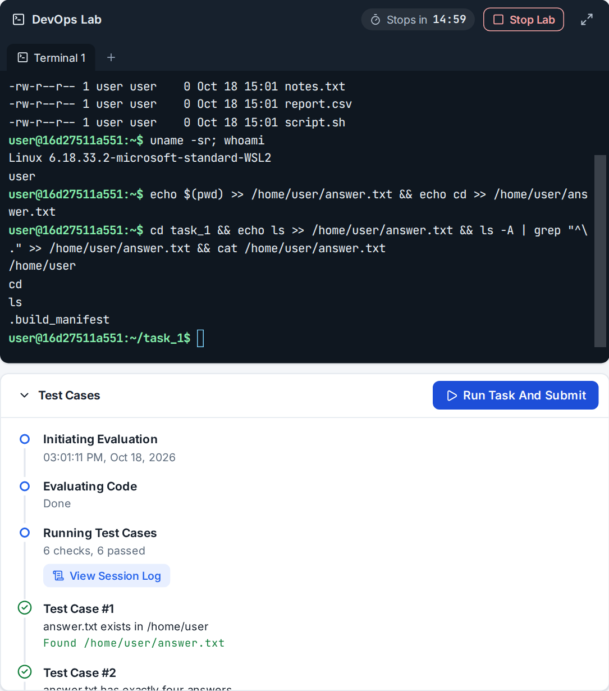
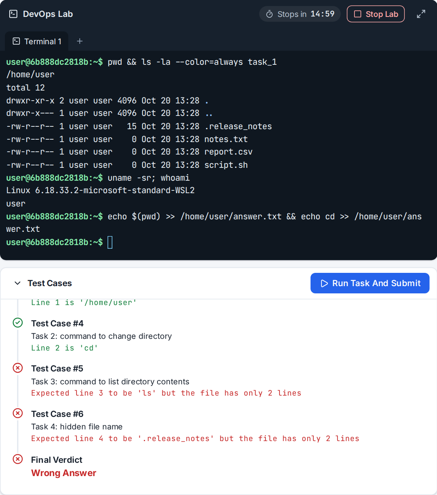
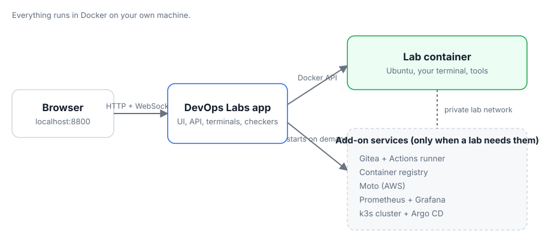

<picture>
  <source media="(prefers-color-scheme: dark)" srcset="docs/images/banner-dark.png">
  
</picture>

DevOps Labs is a free practice platform for DevOps skills that runs on your own computer. Pick a lab, click **Launch Lab**, and you get a real Linux terminal in your browser. Do the task, click **Run Task And Submit**, and automatic checks tell you exactly what is right and what is not.

It has 64 labs in 19 topics: Linux, shell scripting, networking, Git, Docker, Kubernetes, Helm, GitHub Actions, DevSecOps, Terraform, cloud networking, monitoring and GitOps.



##  What you need

- **Docker**: [Docker Desktop](https://www.docker.com/products/docker-desktop/) on Windows or macOS, or Docker Engine with the Compose plugin on Linux.
- **Git**: [git-scm.com](https://git-scm.com/downloads).
- **Memory**: give Docker at least **4 GB** for the Linux, Docker and Terraform labs. The Kubernetes labs need about **6 GB**, and the GitOps lab with Argo CD about **8 GB**.

Windows note: if Docker Desktop uses WSL and has too little memory, see [Low memory](#low-memory) below.

##  Install and start

1. Open a terminal.

   Windows: open **PowerShell**. macOS: open **Terminal**. Linux: open your terminal app.

2. Download DevOps Labs.

   ```
   git clone https://github.com/brixdorf/devops-labs.git
   ```

3. Go into the folder.

   ```
   cd devops-labs
   ```

4. Start it. The first start takes a few minutes.

   ```
   docker compose up -d
   ```

5. Open the app in your browser.

   ```
   http://localhost:8800
   ```

##  How to use it

1. Choose a topic at the top and a lab (Q1, Q2, ...) on the left.
2. Read the question, then click **Launch Lab**.
3. Do the task in the terminal. Click **+** for a second terminal tab.
4. Click **Run Task And Submit** to check your work. Fix what failed and submit again.
5. Stuck? The **Help with Problem Solving** tab has a hint, an approach and the full solution (viewing the solution halves your score for that lab).

Your progress is saved in your browser. A lab stops by itself after 15 minutes without activity.



| Correct answer | Wrong answer |
| --- | --- |
|  |  |

##  Stop

Run this in the `devops-labs` folder. It also removes any running lab.

```
docker compose down
```

Start again later with `docker compose up -d`.

##  Get newer labs

1. Download the latest version.

   ```
   git pull
   ```

2. Rebuild and restart.

   ```
   docker compose up -d --build
   ```

##  Uninstall

1. Remove everything DevOps Labs created in Docker (containers, images, volumes and networks).

   ```
   docker compose run --rm uninstall
   ```

2. Delete the `devops-labs` folder as you would delete any folder.

##  How it works

<picture>
  <source media="(prefers-color-scheme: dark)" srcset="docs/images/architecture-dark.svg">
  
</picture>

Everything runs in Docker on your computer. Nothing is sent anywhere, and there are no accounts.

##  Troubleshooting

### Port already in use

Another program uses port 8800. Copy the settings file, open `.env` in a text editor, change `DEVOPS_LABS_PORT=8800` to a free port such as `8900`, then run `docker compose up -d` again.

```
cp .env.example .env
```

### Docker is not running

Errors such as "cannot connect to the Docker daemon" mean Docker is not started. Start Docker Desktop (or the Docker service on Linux), wait until it says it is running, then try again. This command must work:

```
docker info
```

### Low memory

If Kubernetes labs fail to start or are very slow, give Docker more memory.

- Docker Desktop on macOS, or on Windows without WSL: **Settings**, **Resources**, **Memory**.
- Docker Desktop on Windows with WSL: create the file `.wslconfig` in your user folder (for example `C:\Users\you\.wslconfig`) with the two lines `[wsl2]` and `memory=8GB`, then run `wsl --shutdown` and start Docker Desktop again.

### The first launch of a lab is slow

The first lab of each kind (Linux, Docker, Kubernetes, Terraform, Git server and so on) prepares its environment, which can take a few minutes and needs the internet. The app shows "Preparing environment, first time only". Later launches reuse it and take seconds.

## More

- [Adding a lab](docs/authoring-labs.md)
- [Maintainer guide: tests and version updates](docs/maintainers.md)
- [Design decisions](docs/decisions.md)

DevOps Labs is released under the [MIT License](LICENSE). Icons are from [Lucide](https://lucide.dev) ([ISC License](docs/images/icons/LICENSE)). Fonts: Inter and JetBrains Mono (SIL Open Font License).
